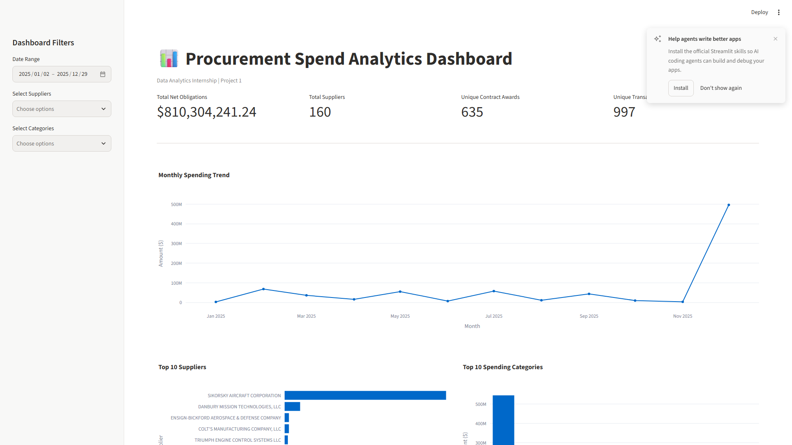
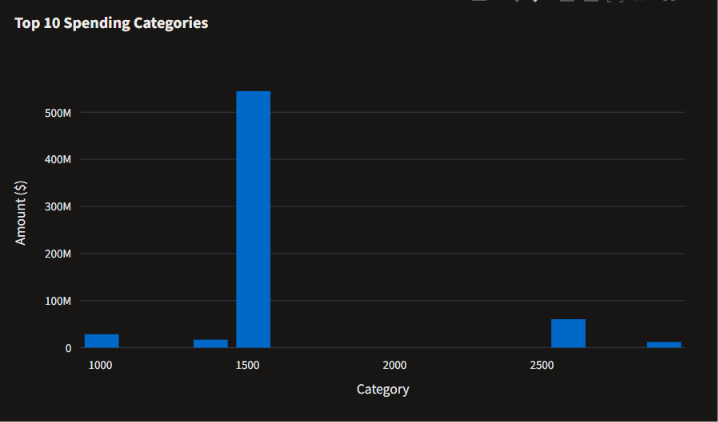
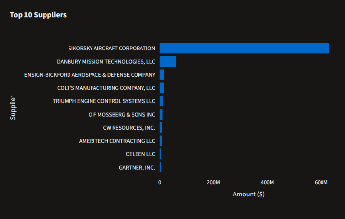
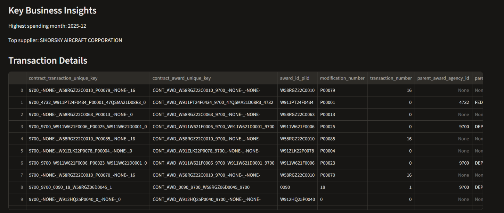

import pandas as pd
from pathlib import Path

files = list(Path("data/raw").glob("*.csv"))

if not files:
    raise FileNotFoundError("Add a CSV to data/raw first.")

df = pd.read_csv(files[0], low_memory=False)

print("Rows and columns:", df.shape)
print("\nColumn names:")
print(df.columns.tolist())

print("\nFirst 10 rows:")
print(df.head(10).to_string())

print("\nMissing values:")
print(df.isnull().sum())

# Procurement Spend Analytics Dashboard

## Project Overview

This project is part of a Data Analytics Internship
focused on procurement analytics, data cleaning,
SQL analysis, and interactive dashboard development.

The application analyzes publicly available US
government contract transaction data to identify
spending patterns, supplier concentration, and
product or service category trends.

## Project Objectives

- Analyze government procurement spending.
- Identify the top 10 suppliers.
- Understand monthly spending trends.
- Analyze spending across product categories.
- Calculate supplier concentration.
- Build an interactive analytics dashboard.

## Technologies Used

- Python
- Pandas
- DuckDB
- SQL
- Streamlit
- Plotly
- OpenPyXL
- Visual Studio Code
- Git and GitHub

## Data Source

Source: USAspending.gov

Website: https://www.usaspending.gov/

Agency: [Enter selected agency]
Reporting period: [Enter selected year]
Download date: [Enter download date]

The project uses publicly available contract
transaction data.

Raw and cleaned datasets are excluded from GitHub
to reduce repository size.

## Data Cleaning

- Standardized column names.
- Removed duplicate records.
- Converted transaction dates.
- Converted obligation amounts to numeric values.
- Handled missing supplier names.
- Removed records with invalid dates or amounts.
- Created monthly reporting fields.
- Retained negative obligation adjustments.

## Key Performance Indicators

- Total Net Federal Obligations
- Total Suppliers
- Total Transactions
- Top 10 Supplier Concentration

Federal obligations represent financial commitments
and are not necessarily actual payments.

## Dashboard Features

- Interactive date range filter
- Supplier selection filter
- Product category filter
- Monthly spending visualization
- Top 10 suppliers visualization
- Category spending visualization
- Supplier concentration analysis
- Transaction details
- Filtered CSV download

## Project Structure

    data-analytics-internship/
    |-- data/
    |   |-- raw/
    |   |-- cleaned/
    |-- scripts/
    |   |-- explore_data.py
    |   |-- clean_data.py
    |   |-- analyze_data.py
    |   |-- create_dictionary.py
    |-- dashboard/
    |   |-- app.py
    |-- sql/
    |   |-- spend_analysis.sql
    |-- reports/
    |   |-- data_dictionary.xlsx
    |   |-- dashboard_overview.png
    |   |-- monthly_spending.png
    |   |-- supplier_category_analysis.png
    |   |-- filtered_dashboard.png
    |-- requirements.txt
    |-- .gitignore
    |-- README.md

## Installation and Execution

1. Install Python.

2. Create a virtual environment:

       python -m venv .venv

3. Activate the virtual environment on Windows:

       .\.venv\Scripts\Activate.ps1

4. Install dependencies:

       python -m pip install -r requirements.txt

5. Download the selected USAspending contract
   transaction CSV and place it inside data/raw/.

6. Explore the dataset:

       python scripts/explore_data.py

7. Clean the dataset:

       python scripts/clean_data.py

8. Perform SQL analysis:

       python scripts/analyze_data.py

9. Generate the data dictionary:

       python scripts/create_dictionary.py

10. Launch the dashboard:

       python -m streamlit run dashboard/app.py

## Dashboard Screenshots

### Dashboard Overview

### Monthly Spending

### Supplier and Category Analysis

### Filtered Dashboard

## Key Findings

- Sikorsky Aircraft Corporation is the leading
  supplier in the displayed supplier analysis.
- Procurement obligations are concentrated among
  a relatively small number of leading suppliers.
- Spending varies across product and service categories.

## Validation

Dashboard results should be compared against SQL
query results to verify financial totals, supplier
counts, transaction counts, and spending trends.

## Future Enhancements

- Unique procurement order analysis
- Rolling 12-month spending analysis
- Improved category descriptions
- Automated data quality checks
- Supplier name standardization

## Author

Nandi Geetha Krishnama Naidu

Data Analytics Internship - Project 1

## Dashboard Screenshots

### Dashboard Overview

### Monthly Spending

### Supplier and Category Analysis

### Filtered Dashboard

