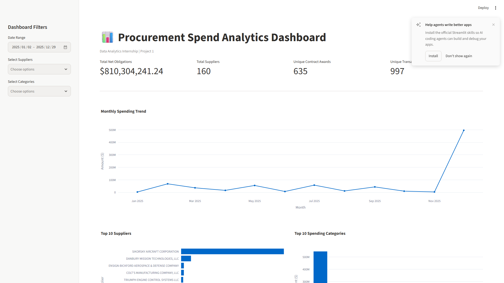

# Project 3 - Smart Column Mapper

## Project Overview

The Smart Column Mapper automatically identifies and maps
inconsistent procurement dataset column names to a
standardized schema using rule-based matching and
RapidFuzz text similarity.

## Business Objective

Organizations receive procurement data from multiple
suppliers with inconsistent column names.

This project automates column standardization, reduces
manual data preparation and identifies uncertain
mappings for human review.

## Technologies Used

- Python
- Pandas
- Faker
- RapidFuzz
- OpenPyXL
- Regular Expressions
- Git and GitHub
- Visual Studio Code

## Dataset

- 20 synthetic procurement CSV files
- 100 records per file
- 2,000 total procurement records
- 160 expected column mappings
- Answer key for accuracy evaluation

## Standard Column Schema

1. description
2. quantity
3. unit_price
4. total_spend
5. supplier
6. manufacturer
7. part_number
8. date

## Methodology

### 1. Synthetic Data Generation

Generated procurement datasets with inconsistent
column names, abbreviations and naming conventions.

### 2. Header Normalization

- Convert headers to lowercase
- Normalize Unicode characters
- Remove special characters
- Replace underscores with spaces
- Remove unnecessary whitespace

### 3. Rule-Based Matching

The first algorithm uses predefined synonyms,
abbreviations and keyword matching.

Scoring rules:

- Exact match: 100
- Known synonym: 95
- Complete keyword match: 85
- Partial keyword match: 65
- No match: 0

### 4. RapidFuzz Matching

The second algorithm uses the RapidFuzz WRatio
similarity function to compare normalized headers
against standard fields and known synonyms.

### 5. Confidence Scoring

Both algorithms use a confidence threshold of 80.

Mappings below the threshold are flagged for human
review. Unassigned headers are also flagged.

One-to-one mapping prevents multiple source headers
from being automatically assigned to the same
standard field within a file.

## Evaluation Metrics

- Overall accuracy
- Mapping precision
- Mapping coverage
- Correct mappings
- Incorrect mappings
- Unmapped headers
- Average confidence score
- High-confidence errors

## Acceptance Criteria

- Minimum overall accuracy of 90%
- 20 synthetic datasets
- 160 evaluated column mappings
- Comparison of both matching algorithms
- Human review for uncertain mappings

## Evaluation Results

Actual results are available in:

reports/algorithm_comparison.csv

The final Excel evaluation report contains:

- Algorithm Comparison
- Detailed Results
- Mapping Errors

## Project Structure

project3/
    data/
    scripts/
        standard_fields.py
        generate_test_data.py
        header_cleaner.py
        rule_based_mapper.py
        fuzzy_mapper.py
        evaluate_mappers.py
        final_validation.py
    tests/
        answer_key.csv
    reports/
    README.md

## Execution Instructions

Run the following commands from the repository root:

    pip install pandas faker rapidfuzz openpyxl

    python project3/scripts/generate_test_data.py
    python project3/scripts/header_cleaner.py
    python project3/scripts/rule_based_mapper.py
    python project3/scripts/fuzzy_mapper.py
    python project3/scripts/evaluate_mappers.py
    python project3/scripts/final_validation.py

## Limitations

- Evaluation is based on synthetic procurement data.
- Confidence scores are heuristic similarity scores,
  not calibrated probabilities.
- Both methods share a predefined synonym dictionary.
- Greedy matching may not always produce the optimal
  global assignment.
- Real-world supplier datasets require further testing.

## Future Enhancements

- Semantic matching using embeddings
- Machine learning-based column classification
- Global optimal assignment
- Human review dashboard
- Automatic synonym learning
- REST API integration
- Real-world procurement dataset validation

## Author

Krishna Nandi

Data Analytics Internship

## Project Status

Implementation prepared. Final acceptance depends on
the generated validation results.
## Dashboard Preview

